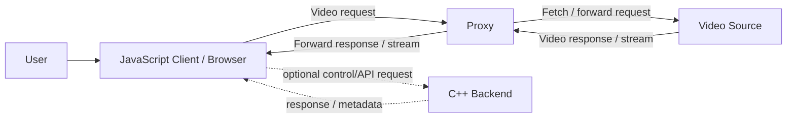
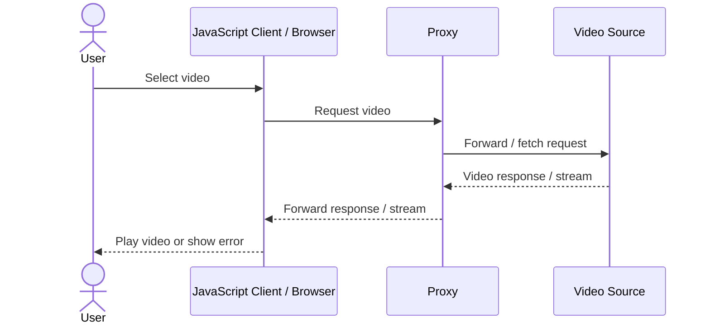

# Initial System Architecture

> **Status:** Draft — requires review by Backend, Client, and Project teams  
> **Sprint:** 1  
> **Scope:** Video delivery through a JavaScript client, C++ backend, and proxy component  
> **Important:** This document is an initial proposal based on limited project information. Confirm the actual responsibilities, protocols, and deployment topology with the development teams before treating it as final.

## 1. Purpose

This document describes the proposed high-level structure of the system, the responsibilities of its main components, the video data flow, communication options, and decisions that need to be confirmed.

## 2. Goals and Out of Scope

### Goals
- Separate browser/UI responsibilities from backend processing.
- Make the video request and delivery path understandable.
- Define clear component ownership and communication boundaries.
- Record architectural decisions and unresolved questions.

### Out of scope for this draft
- Implementation details not yet confirmed in the repository.
- Choosing a final streaming format or transport without requirements.
- Performance, security, and deployment guarantees that have not been tested.

## 3. Proposed System Overview

**Interpretation:** The browser requests a video through the proxy. The proxy forwards or processes the request and returns the response to the browser. The C++ backend may provide control logic, metadata, or other backend services, but its exact relationship to the proxy must be confirmed. If the proxy is implemented inside the C++ backend, update the diagram to show one component instead of two.

## 4. Component Responsibilities

| Component | Proposed responsibility | Owner / confirmation |
|---|---|---|
| JavaScript Client | UI, user actions, initiating playback/request, displaying loading and error states | Client team |
| Browser Video Player | Decoding and rendering supported video formats; playback controls | Client team / browser capabilities |
| C++ Backend | Backend logic, request validation, coordination, and any project-specific processing | Backend team must confirm exact scope |
| Proxy | Receives client requests and forwards them to the video source; may apply routing, filtering, or response handling if required | Confirm whether separate process/service or part of C++ backend |
| Video Source | Origin that stores or serves the video | External service, file server, or project source — confirm |
| Configuration / Logging (if present) | Runtime settings, diagnostics, and error logs | Team decision; do not assume an implementation exists |

### Responsibility boundaries
- The client should not contain secrets or privileged server credentials.
- The backend/proxy should validate requests and handle errors at the appropriate boundary.
- Avoid duplicating the same business logic in the client and backend.
- Keep responsibilities aligned with the actual implementation and agreed team ownership.

## 5. Video Data Flow

### Proposed happy path
1. The user selects a video in the JavaScript client.
2. The client creates a request for the video or for a backend endpoint that identifies the video.
3. The request reaches the proxy endpoint.
4. The proxy validates or routes the request as required and requests the video from the source.
5. The source returns the video response or stream.
6. The proxy forwards the response to the client.
7. The browser video player consumes the response and renders playback.
8. Errors (missing video, rejected request, unavailable source, or interrupted transfer) are reported and handled by the relevant component.

**Confirm:** Whether the browser talks directly to the proxy, whether the C++ backend sits in the request path, whether the proxy modifies or only forwards data, and whether the source supports byte-range requests for seeking.

## 6. Communication Protocols

These are candidate choices, not final decisions.

| Communication | Candidate | Why it may fit | Questions to confirm |
|---|---|---|---|
| Browser ↔ Proxy | HTTP/HTTPS | Standard request/response model; works with browser media requests | Is the endpoint HTTP-based? Is HTTPS required in the target environment? |
| Proxy ↔ Video Source | HTTP/HTTPS, if the source exposes an HTTP endpoint | Common for fetching and forwarding video | Is the source a URL, local file, or another service? |
| Client ↔ C++ Backend | HTTP API if request/response is sufficient; WebSocket only if bidirectional real-time messages are required | Keep communication simple and fit the actual use case | Does the client need to call the backend directly? |
| Internal components | Depends on process boundaries and existing implementation | Avoid adding a protocol where a direct function call is sufficient | Are components separate processes or modules in one process? |

### Protocol selection principles
- Prefer the simplest protocol that meets functional requirements.
- Use HTTPS where traffic crosses an untrusted network or credentials/data require protection.
- Use HTTP byte-range support if playback seeking is required and the chosen player/source path supports it.
- Do not choose WebSocket, TCP sockets, or a custom protocol without a concrete requirement.
- Confirm the actual request/response formats, endpoint paths, status/error behavior, and ownership with the development teams.

## 7. Error Handling and Observability

At minimum, agree on how the system handles:
- Invalid or missing video identifiers.
- Video source unavailable or slow.
- Proxy/backend errors.
- Interrupted transfers and playback failures.
- Unsupported media formats.
- Access-control failures, if access control exists.

Recommended baseline:
- Return meaningful HTTP status codes for HTTP endpoints.
- Log enough context to diagnose failures without logging secrets or sensitive data.
- Make the client display a useful error state and allow retry where appropriate.
- Agree on request IDs/correlation IDs if multiple services are involved.

These are recommendations; confirm what is in scope for Sprint 1.

## 8. Security Considerations

- Validate incoming identifiers and request parameters.
- Do not expose private source credentials in JavaScript or browser-visible configuration.
- Restrict proxy behavior to approved sources/targets to avoid unintended open-proxy behavior.
- Apply access checks if videos are private or restricted.
- Use HTTPS where appropriate for the deployment environment.
- Avoid logging authorization headers, tokens, or other secrets.

## 9. Technical Decisions and Open Questions

Decisions that must be confirmed before final approval:
1. Is Proxy a separate service/process or part of the C++ backend?
2. Does the C++ backend participate in the video bytes path, or only provide control/metadata?
3. What exactly is the video source: remote URL, local files, or a dedicated server?
4. Is playback progressive download, byte-range streaming, or an adaptive streaming format?
5. Which endpoints and request/response formats will be used?
6. Is authentication/access control required?
7. What are the deployment target and network constraints?

## 10. Sprint 1 Deliverables Checklist

- [ ] Review this proposal with the C++ Backend team.
- [ ] Review the client request/playback flow with the JavaScript team.
- [ ] Confirm whether Proxy is independent or part of the backend.
- [ ] Replace assumptions with verified implementation details.
- [ ] Approve the component responsibility table.
- [ ] Confirm protocols and endpoint contracts with developers.
- [ ] Finalize the system and sequence diagrams.
- [ ] Add or update ADRs for important decisions.
- [ ] Commit the final document to `docs/architecture.md`.

## 11. Change History

| Version | Status | Notes |
|---|---|---|
| 0.1 | Draft | Initial proposal; assumptions require team validation |
