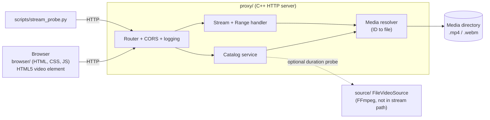
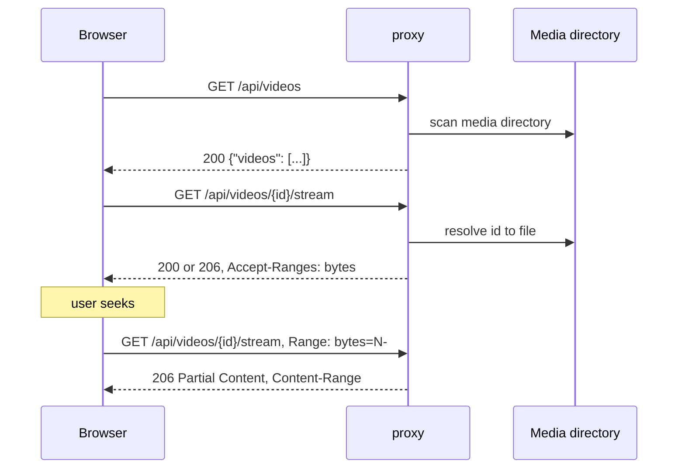

# Architecture

**Status:** Draft v0.1 — Architecture Team, Sprint 2 (for team review)

## 1. Summary

The browser plays video from the C++ `proxy/` server using **HTTP progressive streaming**. The server sends the **original encoded file** (e.g. MP4) and supports **byte-range requests** so the HTML5 `<video>` element can seek. Decoded RGB frames from FFmpeg are **not** part of this path, because a `<video>` element cannot play raw RGB frames.

## 2. Components

| Component | Folder | Responsibility |
|---|---|---|
| Browser client | `browser/` | Loads the catalog, renders the list, plays the selected video in an HTML5 `<video>` element, shows states and errors. |
| Proxy (HTTP server) | `proxy/` | Router, CORS, catalog, media resolver (ID → file), stream and range handler, logging. |
| Existing video code | `source/` | `FileVideoSource` (FFmpeg → RGB frames). **Not used in the streaming path.** Optionally reused later to read duration metadata. |
| Media directory | configured path | Holds the allowed `.mp4` / `.webm` files. |
| Diagnostic tool | `scripts/stream_probe.py` | Calls the public API to check health, catalog, range behavior, and performance. |
| Tests | `tests/`, `*/tests/` | Unit, integration, system, performance. |

## 3. Diagrams

Source files are in `docs/uml/`.

### Component / data flow

### Play and seek sequence

Browsers usually send `Range: bytes=0-` on the first request, so the first response may already be `206`.

## 4. Decisions

| # | Decision | Reason |
|---|---|---|
| D1 | Transport is HTTP/1.1 progressive streaming with `Range`. | Works natively with `<video>`; no new protocol or framework. |
| D2 | The server sends original files; no decoding or transcoding. | RGB frames are not playable by `<video>`; transcoding is out of scope. |
| D3 | `source/` is not in the stream path. | Keeps the backend simple and removes an FFmpeg dependency from streaming. |
| D4 | Server library: **cpp-httplib** (header-only, MIT, thread pool, content-provider streaming, easy CMake `FetchContent`). | Smallest addition to the existing CMake build. C++ team may propose an alternative before implementation starts. |
| D5 | Server listens on `127.0.0.1:8080` by default. | Local development only. |
| D6 | Config priority: CLI flags, then environment variables, then defaults (see `protocol.md` §2). | Predictable and testable. |
| D7 | Allowed media: `.mp4` and `.webm`, non-recursive scan of the media directory. | Browser-compatible and simple. |
| D8 | Video ID = slug of the file name (see `protocol.md` §4). | Stable, readable, and never a path. |
| D9 | CORS enabled for `/api/*` in development, because the browser may be served from a different origin than the API. | Avoids blocking local development. |
| D10 | The catalog is rescanned on each `GET /api/videos`; stream lookup uses the same rules. | No restart needed when files are added; small directories only. |
| D11 | No authentication in Sprint 2 & 3. | Out of scope. |
| D12 | The browser and Python tool get the server URL from configuration (`browser/js/config.js`, `--base-url`). | No hard-coded hosts. |
| D13 | Test media lives in `tests/fixtures/` and is generated by a script, not downloaded. | Avoids licensing problems; see `testing.md`. |

## 5. Concurrency, cleanup, logging

- Concurrency: thread pool, minimum 10 simultaneous streams (NFR-03).
- Every file handle, buffer, and socket must be released on success, error, and client disconnect.
- One log line per request to stderr: timestamp, method, path, status, bytes sent, duration. Do not log filesystem paths or full headers.

## 6. Unresolved decisions (need an answer before the dependent work)

| # | Question | Needed by | Default if no answer |
|---|---|---|---|
| U1 | Does the C++ team accept cpp-httplib (D4)? | Start of C++ Sprint 2 | Use cpp-httplib |
| U2 | Is a duration field needed in the catalog? | Mid Sprint 2 | Field exists, value is `null` |
| U3 | Should `HEAD` on the stream endpoint be implemented? | Sprint 3 | Optional |
| U4 | Does the Jest setup live in `browser/` or `tests/unit/`? | JS Sprint 2 | Keep where it already is |
| U5 | Are multiple qualities required? (Out of scope today.) | Before Sprint 3 starts | Not in these sprints |

## 7. Component acceptance criteria

- **proxy/**: starts from documented steps; implements every route in `protocol.md`; passes the error and range cases.
- **browser/**: all data comes from the API; implements the states listed in `protocol.md` §9.
- **scripts/stream_probe.py**: verifies the status codes and headers listed in `protocol.md`.
